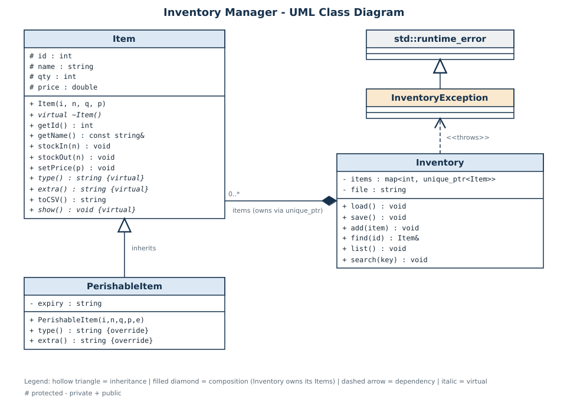

# Inventory Manager (C++)

A console-based application that helps a shopkeeper keep track of stock: add
items, search them, record stock coming in and going out, change prices, and
keep the data saved between runs.

Built as the mini project for the **C++ Programming Practical Manual**
(RSSOFTTECS Solutions Pvt. Ltd.).

## Problem solved
A small shop needs to know how much of each item is in stock and what it costs,
and must never record selling more than it has. This program replaces the
notebook: it stores every item, blocks impossible stock changes, and saves
everything to a CSV file so nothing is lost when the program closes.

## Users
- **Shop owner / storekeeper** - adds items, records stock-in and stock-out, updates prices.

## Features
- Add a normal item or a **perishable** item (perishable items also store an expiry date).
- List all items with quantity, price and type; search by part of the name.
- Stock in and stock out; removing more than is in stock is rejected, so quantity never goes negative.
- Update the price of an item.
- Clear error messages for: duplicate ID, unknown ID, negative quantity or price,
  zero or negative stock change, removing more than available, and invalid (non-numeric) input.
- Data is saved to `inventory_data.csv` on exit and loaded again at start-up.

## Concepts used
| Concept | Where |
|---|---|
| Classes, encapsulation, constructors | `Item`, `PerishableItem`, `Inventory` (protected/private data, public methods) |
| Inheritance and polymorphism | `PerishableItem` extends `Item` and overrides virtual `type()` and `extra()`; `Inventory` calls `show()` through an `Item` pointer, so each object reports its own type |
| STL containers | `std::map<int, std::unique_ptr<Item>>` keeps items sorted by ID with fast lookup |
| Smart pointers | `std::unique_ptr` / `std::make_unique` own each item; no manual `new` or `delete` |
| Exception handling | custom `InventoryException`, plus `std::invalid_argument` for bad input |
| File I/O | CSV reading and writing with `ifstream` / `ofstream` |

## Project structure
```
inventory-manager/
|-- src/
|   |-- main.cpp          # classes + menu
|   `-- common.h          # input helpers (readLine, readInt, readDouble)
|-- docs/
|   |-- uml_class_diagram.png
|   |-- uml_class_diagram.svg
|   `-- sample_output.txt # real program output (two runs)
|-- sample_data/
|   `-- inventory_data.csv  # example data file
|-- .vscode/tasks.json    # Cmd/Ctrl+Shift+B builds the project in VS Code
|-- Makefile
|-- .gitignore
`-- README.md
```

## Requirements
- A C++17 compiler (g++ 7 or newer, or clang++)
- `make` (optional)

## Build and run
```bash
# using make
make
./inventory

# or directly
g++ -std=c++17 -Wall -Wextra -o inventory src/main.cpp
./inventory
```
On the first run the program starts with an empty inventory and creates
`inventory_data.csv` when you choose **0 (Save & exit)**. To start with example
data, copy the sample file first:
```bash
cp sample_data/inventory_data.csv .
./inventory
```

## Menu
```
1 Add | 2 List | 3 Search | 4 Stock in | 5 Stock out | 6 Price | 0 Save & exit
```

## CSV format
One item per line: `type,id,name,quantity,price,expiry`
(`expiry` is empty for normal items). Names must not contain commas.
```
Normal,1,Pen,70,10,
Perishable,3,Milk,0,28,2026-12-01
```

## Class diagram


## Sample output
A full session (normal use, error cases, then a restart that reloads the saved
file) is in [`docs/sample_output.txt`](docs/sample_output.txt). Short extract:
```
== INVENTORY MENU: 1 Add | 2 List | 3 Search | 4 Stock in | 5 Stock out | 6 Price | 0 Save & exit ==
Choice: 5
Item ID: 1
Quantity to remove: 500
Inventory error: Only 70 in stock, cannot remove 500
```

## Possible improvements
- Low-stock warnings and an expiry-date check for perishable items
- Support commas in names by quoting CSV fields
- Unit tests for the `Inventory` class

## Author
Name: ____________________  Roll No: ________  Class: ________
